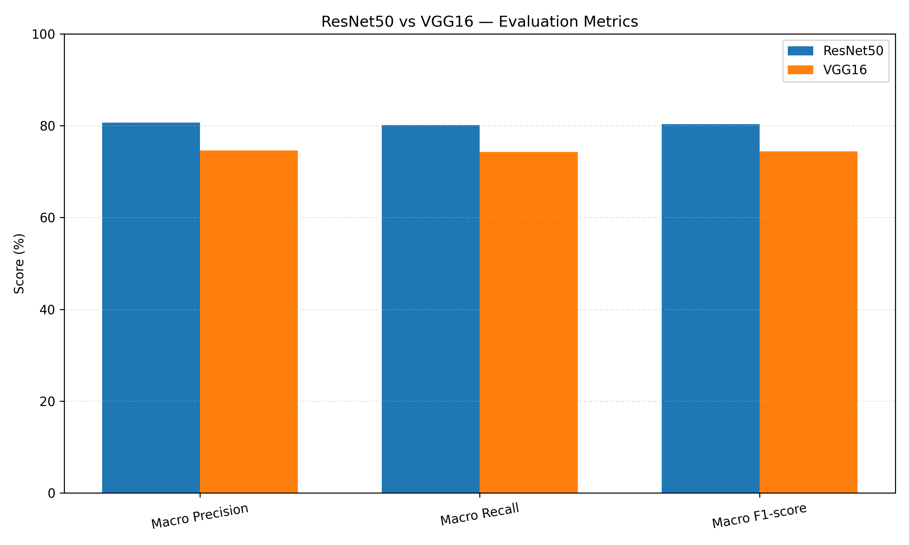
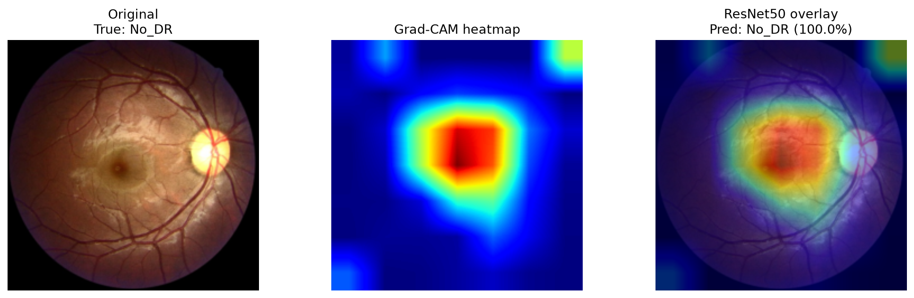

# Explainable Deep Learning-Based Diabetic Retinopathy Detection and Severity Classification Using Retinal Fundus Images

## Overview

This project presents a deep learning-based approach for detecting and classifying Diabetic Retinopathy (DR) from retinal fundus images. It uses transfer learning with ResNet50 and VGG16 and incorporates Grad-CAM (Gradient-weighted Class Activation Mapping) to visualize the regions of retinal images influencing model predictions.

The dataset contains 12,522 labeled retinal images across five diabetic retinopathy severity classes. The project evaluates model performance using classification metrics and visualizes predictions using Grad-CAM heatmaps.

## Objectives

- Classify retinal fundus images into five DR severity levels.
- Compare ResNet50 and VGG16 using evaluation metrics.
- Evaluate classification performance using accuracy, precision, recall, and F1-score.
- Generate confusion matrices and comparison visualizations.
- Apply Grad-CAM to explain model predictions visually.

## Dataset

The dataset contains 12,522 labeled images. It is not included in this repository because of its size.

| Label | Severity class |
|---|---|
| 0 | No DR |
| 1 | Mild DR |
| 2 | Moderate DR |
| 3 | Severe DR |
| 4 | Proliferative DR |

## Technologies Used

- Python
- PyTorch and torchvision
- NumPy and Pandas
- Matplotlib
- Scikit-learn
- Grad-CAM / explainable AI techniques

## Models Compared

### ResNet50

ResNet50 uses residual connections to learn deep image representations. Transfer learning adapts its pretrained features to the five-class DR classification task.

### VGG16

VGG16 uses stacked convolutional layers to extract visual features. It serves as the comparison architecture for evaluating classification performance.

## Model Comparison Results

| Evaluation metric | ResNet50 | VGG16 |
|---|---:|---:|
| Accuracy | 80.84% | 74.27% |
| Macro precision | 66.60% | 74.64% |
| Macro recall | 62.43% | 74.27% |
| Macro F1-score | 64.07% | 74.39% |
| Weighted F1-score | 80.35% | 74.39% |

ResNet50 achieved higher overall accuracy, while VGG16 achieved stronger macro-averaged precision, recall, and F1-score.

## ResNet50 vs VGG16 Comparison Visualization

The project includes a generated comparison chart:

`resnet50_vs_vgg16_comparison/resnet50_vs_vgg16.png`

The numerical results are stored in:

`resnet50_vs_vgg16_comparison/comparison_metrics.csv`



## Explainable AI Using Grad-CAM

Grad-CAM creates heatmaps that highlight regions of a retinal image that contribute to the model's prediction. It helps visualize the image areas associated with the predicted severity class.

Example Grad-CAM output:



**Example interpretation:** The image filename records the ground-truth class as No DR and the ResNet50 prediction as No DR.

The project generates Grad-CAM outputs for both ResNet50 and VGG16.

### Grad-CAM result directories

- `gradcam_both_results/ResNet50/`
- `gradcam_both_results/VGG16/`

Each directory contains generated heatmaps and a `gradcam_predictions.csv` file with prediction information.

Grad-CAM is a visual explanation method; it does not establish a clinical diagnosis.

## Project Structure

```text
DL-proj/
|-- models/
|-- gradcam_both_results/
|   |-- ResNet50/
|   `-- VGG16/
|-- resnet50_vs_vgg16_comparison/
|   |-- comparison_metrics.csv
|   `-- resnet50_vs_vgg16.png
|-- compare_resnet_vgg16.py
|-- gradcam_both_models.py
|-- predict.py
|-- requirements.txt
`-- README.md
```

The `DL dataset/` folder and trained model weights (`*.pth`, `*.pt`) are kept out of the repository.

## Running the Project

Install the required dependencies:

```bash
pip install -r requirements.txt
```

Run the model comparison script:

```bash
python compare_resnet_vgg16.py
```

Generate Grad-CAM visualizations:

```bash
python gradcam_both_models.py
```

Run prediction:

```bash
python predict.py
```

These commands require the corresponding scripts, model weights, dataset paths, and dependencies to be available.

## Limitations

- Model performance depends on dataset quality and class distribution.
- Results may not generalize to external datasets.
- Grad-CAM heatmaps provide approximate visual explanations rather than clinical proof.
- The models are intended for research and educational purposes, not independent medical diagnosis.

## Future Work

- Evaluate the models on independent retinal image datasets.
- Improve performance across underrepresented severity classes.
- Explore additional explainability techniques.
- Develop a user interface for image upload and severity prediction.
- Validate model performance before any clinical application.

## Disclaimer

This project is intended for educational and research purposes only. Its predictions must not be used as a substitute for professional medical diagnosis.

## Author

**Sheevamraj Singh**

Department of Computer Science and Engineering  
Centurion University of Technology and Management  
Bhubaneswar, India